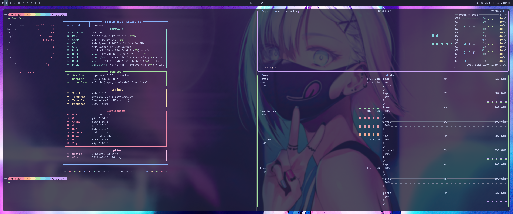
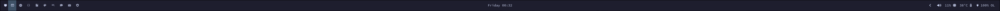
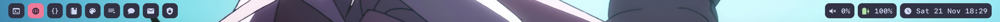
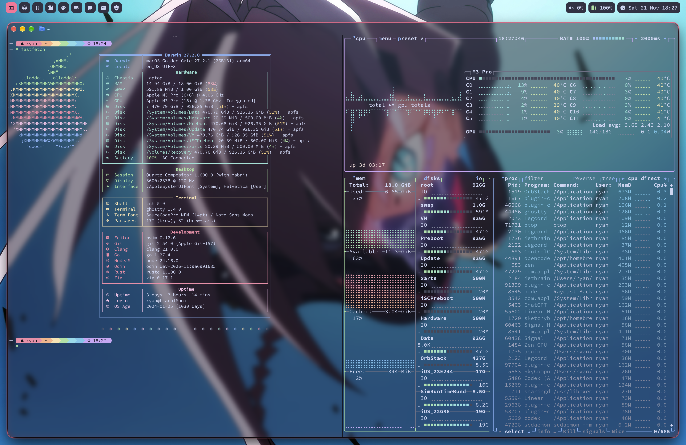
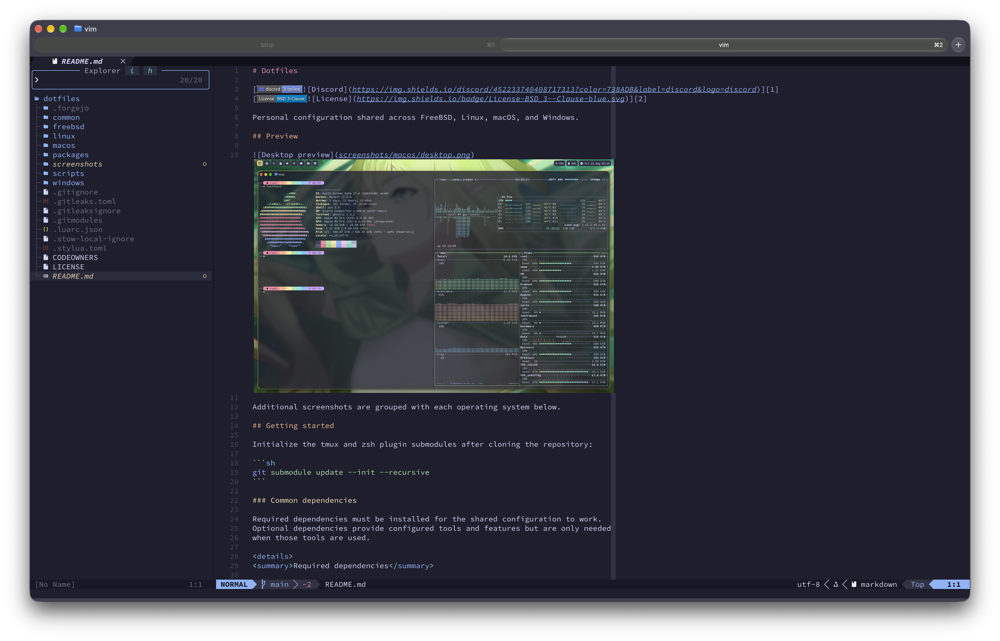

# Dotfiles

[![Discord][badge-discord]][link-discord]
[![License][badge-bsd-3]][link-bsd-3]
[![Checks][badge-workflow-checks]][link-workflow-checks]

Personal configuration shared across FreeBSD, Linux, macOS, and Windows.

## Preview



Additional screenshots are grouped with each operating system below.

## Getting started

Initialize the tmux and zsh plugin submodules after cloning the repository:

```sh
git submodule update --init --recursive
```

### Common dependencies

Required dependencies must be installed for the shared configuration to work.
Optional dependencies provide configured tools and features but are only needed
when those tools are used.

<details>
<summary>Required dependencies</summary>

- [atuin][atuin]
- [fnm][fnm]
- [Git][git]
- [GnuPG][gnupg]
- [GNU Stow][gnu-stow]
- [starship][starship]
- [zoxide][zoxide]
- [zsh][zsh]

</details>

<details>
<summary>Optional dependencies</summary>

- [bat][bat]
- [btop++][btop]
- [bun (deprecated)][bun]
- [delta][delta]
- [eza][eza]
- [fastfetch][fastfetch]
- [fd][fd]
- [fzf][fzf]
- [Go][go]
- [lazygit][lazygit]
- [neovim][neovim]
- [Nerd fonts][nerd-fonts]
- [Node.js][nodejs]
- [Odin][odin]
- [OpenCode][opencode]
- [pnpm][pnpm]
- [ripgrep][ripgrep]
- [rustup (and cargo)][rustup]
- [SDKMAN][sdkman]
- [tmux][tmux]
- [wezterm][wezterm]
- [yazi][yazi]
- [Zen browser][zen-browser]

</details>

## FreeBSD

Preview the changes:

```sh
stow --simulate --verbose --restow --target="$HOME" freebsd
```

Apply the configuration:

```sh
stow --verbose --restow --target="$HOME" freebsd
```

<details>
<summary>Screenshots</summary>

Screenshots will be added under `screenshots/freebsd/`.



</details>

<details>
<summary>Dependencies (2 required, 3 optional)</summary>

### Required

- [Hyprland][hyprland]
- [waybar][waybar]

### Optional

- [Google Fonts][google-fonts]
- [mako][mako]
- [nwg-bar][nwg-bar]

</details>

## Linux

Preview the changes:

```sh
stow --simulate --verbose --restow --target="$HOME" linux
```

Apply the configuration:

```sh
stow --verbose --restow --target="$HOME" linux
```

<details>
<summary>Screenshots</summary>

Screenshots will be added under `screenshots/linux/`.

</details>

<details>
<summary>Dependencies (2 required, 2 optional)</summary>

### Required

- [Hyprland][hyprland]
- [waybar][waybar]

### Optional

- [mako][mako]
- [nwg-bar][nwg-bar]

</details>

## macOS

Preview the changes:

```sh
stow --simulate --verbose --restow --target="$HOME" macos
```

Apply the configuration:

```sh
stow --verbose --restow --target="$HOME" macos
```

In SketchyBar, a pause marker beside the battery percentage (`80% ⏸`) means
the Mac is plugged in but the battery is not charging.

<details>
<summary>Screenshots</summary>





</details>

<details>
<summary>Dependencies (4 required)</summary>

- [Homebrew][homebrew]
- [SketchyBar][sketchybar]
- [skhd][skhd]
- [Yabai][yabai]

</details>

## Windows

Manually create links from the `windows` package into your home directory.

<details>
<summary>Screenshots</summary>

Screenshots will be added under `screenshots/windows/`.

</details>

<details>
<summary>Dependencies (1 required)</summary>

- [PowerShell][powershell]

</details>

## Neovim development tools

Neovim 0.12 or newer is required for the shared plugin configuration.
The language-server tools require Node.js 22.22.2 or newer. Install Go,
Cargo/rustup, and your platform's package manager before running the installer.
Parser installation also requires a C compiler, `tar`, and `curl`; the installer
supplies the Tree-sitter CLI (minimum supported version: 0.26.1).

Launching `vim` without file arguments opens the Snacks explorer in the current
directory, alongside the dashboard. Piped input and restored sessions keep their
normal startup behavior.

Completion uses Blink v1 with LSP, LuaSnip/friendly-snippets, buffer words, and
file paths. `Ctrl-j` / `Ctrl-k` selects the next / previous suggestion,
`Ctrl-Space` opens completion or its documentation, `Enter` accepts the selected
suggestion (or the first if none is selected), and `Ctrl-e` cancels completion.
`Ctrl-b` / `Ctrl-f` scrolls documentation; `Tab` / `Shift-Tab` moves between
snippet placeholders. Blink inserts function-call brackets on completion;
nvim-autopairs handles brackets typed manually. The native fuzzy matcher is
downloaded automatically when supported, with a Lua fallback otherwise.

Editing and Git keybindings (`<leader>` is Space):

- `[c` / `]c`: previous / next Git hunk.
- `<leader>hs` / `<leader>hr`: stage (or unstage) / reset a hunk; also works on
  selected lines in Visual mode. Reset discards those working-tree changes.
- `<leader>hp` / `<leader>hb` / `<leader>hd`: preview hunk / blame line / diff
  against the index.
- `<leader>sr`: open project search and replacement with grug-far. In Visual
  mode, prefill the search with the selection. Use `:GrugFarWithin` to restrict
  replacement to the selected range. Grug-far's buffer actions use the default
  local leader, `\`; its footer shows the available commands. Requires ripgrep
  14 or newer (15 or newer recommended).
- `saiw"`: surround a word with double quotes; `sd"`: delete surrounding double
  quotes; `sr"'`: replace double quotes with single quotes. In Visual mode,
  select text and press `sa` followed by the desired surrounding character.
- `cia` / `daa`: change an argument / delete an argument with its separator
  using mini.ai. `vif` / `vaf` selects inside / around a function call.
- `<leader>j`: Flash jump. Type some target text, then press its displayed label.
  `<leader>J`: label and select Tree-sitter nodes around the cursor. Both work
  in Normal, Visual, and operator-pending modes (for example, `d<leader>j`).
  Flash uses leader mappings so mini.surround's `s` mappings remain available;
  the usual `f` / `t` motions and `/` search retain their existing behavior.
- `<leader>um`: toggle rendered Markdown headings, tables, and code blocks.

Rust uses rustaceanvim to manage rust-analyzer. `<leader>rr` lists runnable
targets, `<leader>rm` expands a macro, and `<leader>rc` opens `Cargo.toml`.
Neotest provides Rust tests through rustaceanvim and Go tests through
neotest-golang; install Rust/Cargo or Go on each host as needed. JavaScript test
runners require a project-appropriate Neotest adapter before they can be used.

C# uses Roslyn for completion, diagnostics, navigation, refactoring, and
formatting (on save or with `<leader>cf`), plus the `c_sharp` Tree-sitter parser.
Install a .NET 10+ SDK for Roslyn and the SDK required by your project.
Open a `.cs` file in a project or solution; use `:Roslyn target` to choose
between multiple solutions. Neotest's existing test shortcuts also support
C# xUnit, NUnit, and MSTest projects through neotest-vstest.

- `<leader>tt` / `<leader>tT`: run the nearest test / current file's tests.
- `<leader>tl` / `<leader>tr`: rerun the last test / stop a test.
- `<leader>ts`: toggle the test summary.
- `<leader>te` / `<leader>tO`: open test output / toggle the output panel.

Tree-sitter highlighting starts for buffers with installed parsers. Tree-sitter
indentation is enabled where an indentation query is available; other filetypes
keep their normal indentation. Run `:TSUpdate` after updating Tree-sitter.

Diagnostic keybindings (`<leader>` is Space):

- `<leader>dd`: show diagnostics for the current line.
- `<leader>db` / `<leader>dp`: toggle a persistent Trouble bottom split for
  buffer / project diagnostics. Press Enter to jump to a diagnostic while
  keeping the list open; press `q` in the list to close it.
- `<leader>sd` / `<leader>sD`: search project / buffer diagnostics in Snacks.
- `[d` / `]d`: jump to the previous / next diagnostic.

Project diagnostics include all diagnostics reported to Neovim; language servers
may only report diagnostics for files that have been opened.

Install the host-level language servers and formatters from the repository's
checked-in manifests:

```sh
scripts/install-neovim-tools
scripts/check-neovim-tools
```

Preview the installation commands without changing the system:

```sh
scripts/install-neovim-tools --dry-run
```

<details>
<summary>Screenshots</summary>



</details>
<details>
<summary>Tooling details</summary>

The installer uses FreeBSD `pkg`, a macOS Brewfile, or the Arch Linux package
manifest for native packages. Version-pinned npm, Go, and Cargo manifests cover
portable tools, while rustup supplies `rust-analyzer` and `rustfmt`. Other Linux
distributions must translate `packages/linux.txt` to their native package
names, then run `scripts/install-neovim-tools --skip-system-packages` to install
the portable tools. This option can be combined with `--dry-run`.
Homebrew and Arch install OLS and `odinfmt` as separate packages.
OLS and `odinfmt` must be installed manually on FreeBSD because they are
not currently available from `pkg`.

The macOS and Arch manifests install the .NET SDK. On FreeBSD, install a
compatible community .NET SDK manually; C# support there has not been
runtime-tested. The installer skips .NET tools when `dotnet` is unavailable.
Pinned global .NET tools are listed in `packages/neovim/dotnet.txt`.
Ensure `~/.dotnet/tools` is on Neovim's `PATH` (included in the shared Zsh config);
restart your shell after updating it. The macOS Zsh configuration also sets
Homebrew's `dotnet@10` path and `DOTNET_ROOT` so global tools can find its runtime.
For other shells, add `$(brew --prefix dotnet@10)/bin` to `PATH` and set
`DOTNET_ROOT` to `$(brew --prefix dotnet@10)/libexec`.
Run `:Lazy sync` and `:TSUpdate` to install the new plugins and parser.

The checker verifies executable availability, minimum Neovim/Node.js/Tree-sitter
versions, Rust component execution, and parser build prerequisites. Run it from
a project or its subdirectories to check local JavaScript libraries; it searches
for the nearest `package.json` and resolves installed packages through ancestor
`node_modules` directories. Undeclared, uninstalled JavaScript tools are optional;
declared tools that cannot be resolved are reported as missing.

All executables must be on the `PATH` inherited by Neovim. The configured
language servers are:

```text
bash-language-server
docker-language-server
gopls
hyprls
lua-language-server
ols
roslyn-language-server
rust-analyzer
sqls
tailwindcss-language-server
taplo
typescript-language-server
vscode-css-language-server
vscode-eslint-language-server
vscode-html-language-server
vscode-json-language-server
yaml-language-server
```

The configured formatters are `gofmt`/`goimports`, `odinfmt`, project-local
`prettier`, `rustfmt`, `shfmt`, `stylua`, and `taplo`. Conform automatically
prefers `node_modules/.bin/prettier` when it exists. The ESLint language server
similarly discovers the project's ESLint installation and configuration, so
diagnostics remain available in Neovim without a global ESLint installation.

`sqls` supports PostgreSQL, MySQL, and SQLite. Database connections can be
defined outside this repository in `$XDG_CONFIG_HOME/sqls/config.yml`; see the
[upstream `sqls` connection configuration][sqls-configuration] for the supported DSN formats.

</details>

[badge-discord]: https://img.shields.io/discord/452233740408717313?color=b4befe&label=discord&labelColor=1e1e2e&logo=discord&style=flat
[link-discord]: https://discord.gg/KTgshSbEUU
[badge-bsd-3]: https://img.shields.io/badge/License-BSD_3--Clause-89b4fa?labelColor=1e1e2e&logo=bsd&logoColor=white&style=flat
[link-bsd-3]: https://opensource.org/license/bsd-3-clause
[badge-workflow-checks]: https://git.9dev.tech/Ixirsii/dotfiles/badges/workflows/checks.yml/badge.svg?branch=main&event=push&label=Checks&labelColor=1e1e2e&style=flat&logo=forgejo&logoColor=white
[link-workflow-checks]: https://git.9dev.tech/Ixirsii/dotfiles/actions/workflows/checks.yml
[atuin]: https://atuin.sh
[fnm]: https://github.com/Schniz/fnm
[git]: https://git-scm.com
[gnupg]: https://gnupg.org
[gnu-stow]: https://www.gnu.org/software/stow/
[starship]: https://starship.rs
[zoxide]: https://github.com/ajeetdsouza/zoxide
[zsh]: https://www.zsh.org
[bat]: https://github.com/sharkdp/bat
[btop]: https://github.com/aristocratos/btop
[bun]: https://bun.com
[delta]: https://github.com/dandavison/delta
[eza]: https://github.com/eza-community/eza
[fastfetch]: https://github.com/fastfetch-cli/fastfetch
[fd]: https://github.com/sharkdp/fd
[fzf]: https://github.com/junegunn/fzf
[lazygit]: https://lazygit.dev
[neovim]: https://neovim.io
[nerd-fonts]: https://www.nerdfonts.com
[nodejs]: https://nodejs.org
[opencode]: https://opencode.ai
[pnpm]: https://pnpm.io
[ripgrep]: https://github.com/BurntSushi/ripgrep
[rustup]: https://rustup.rs
[sdkman]: https://sdkman.io
[tmux]: https://github.com/tmux/tmux
[wezterm]: https://wezterm.org/index.html
[yazi]: https://yazi-rs.github.io
[zen-browser]: https://zen-browser.app
[hyprland]: https://hypr.land
[waybar]: https://github.com/alexays/waybar
[google-fonts]: https://cgit.freebsd.org/ports/tree/x11-fonts/google-fonts
[mako]: https://github.com/emersion/mako
[nwg-bar]: https://github.com/nwg-piotr/nwg-bar
[homebrew]: https://brew.sh
[sketchybar]: https://github.com/FelixKratz/SketchyBar
[skhd]: https://github.com/koekeishiya/skhd
[yabai]: https://github.com/koekeishiya/yabai
[powershell]: https://learn.microsoft.com/en-us/powershell/scripting/install/install-powershell-on-windows?view=powershell-7.6
[sqls-configuration]: https://github.com/sqls-server/sqls#db-configuration
[go]: https://go.dev
[odin]: https://odin-lang.org
